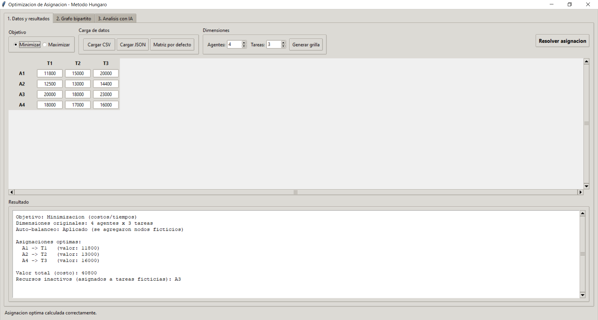
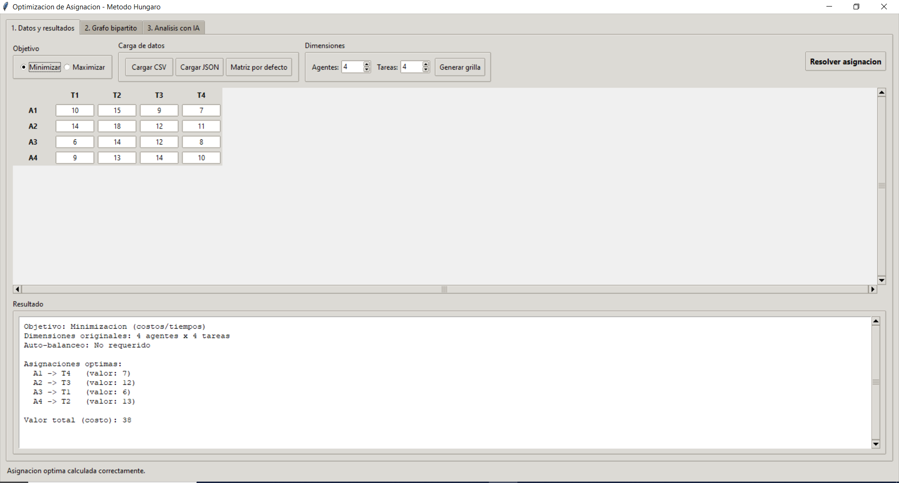
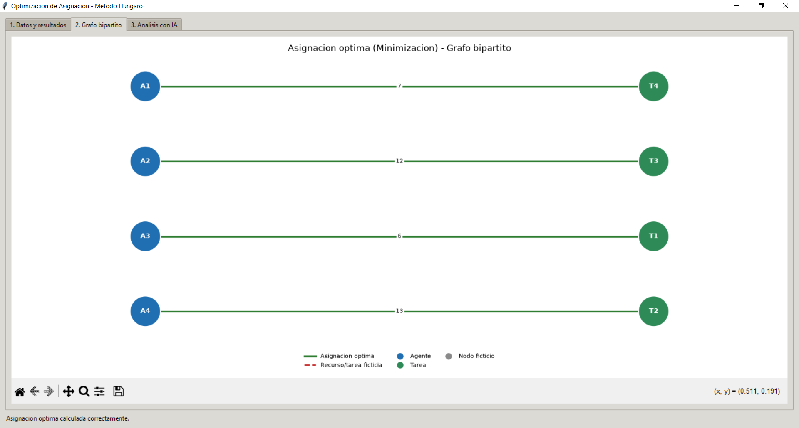
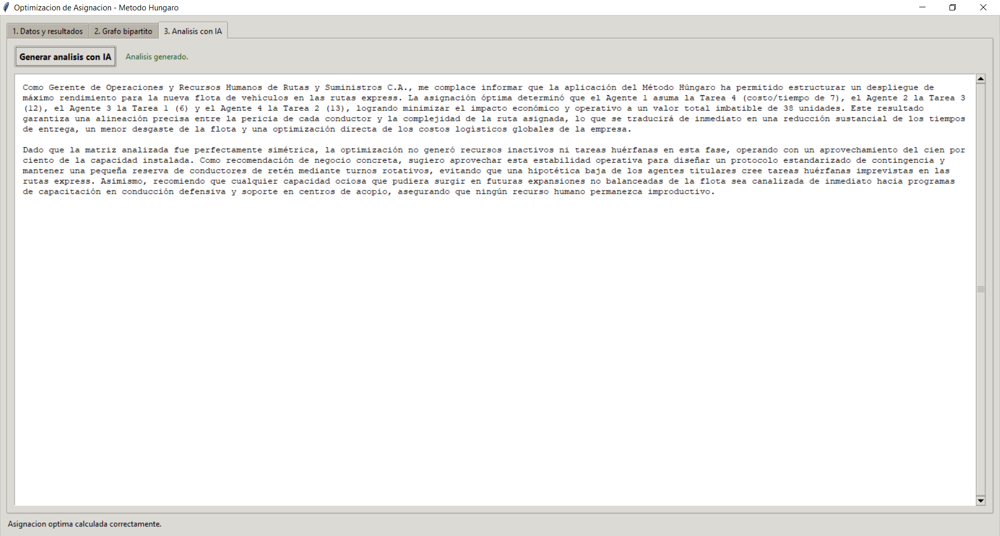

# Proyecto Fase II: Optimización de Asignación de Recursos mediante el Método Húngaro con Soporte Dinámico y Análisis de IA
## Integrantes
**Miguel Maestre y Mauricio Maestre** 

## Ejecución del Programa

Desde la carpeta raíz debe usar python main.py 

## Salida del Programa

## Grafo Bipartito Generado

## Conclusión del Agente de Inteligencia Artificial
